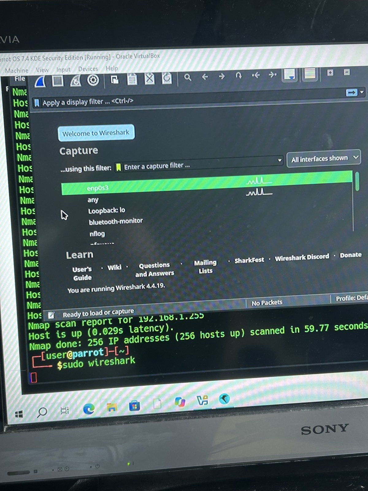
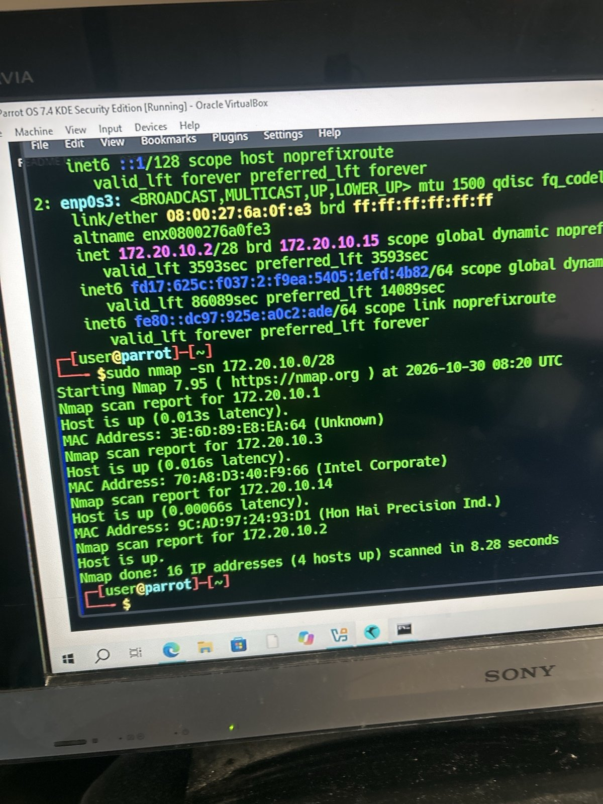
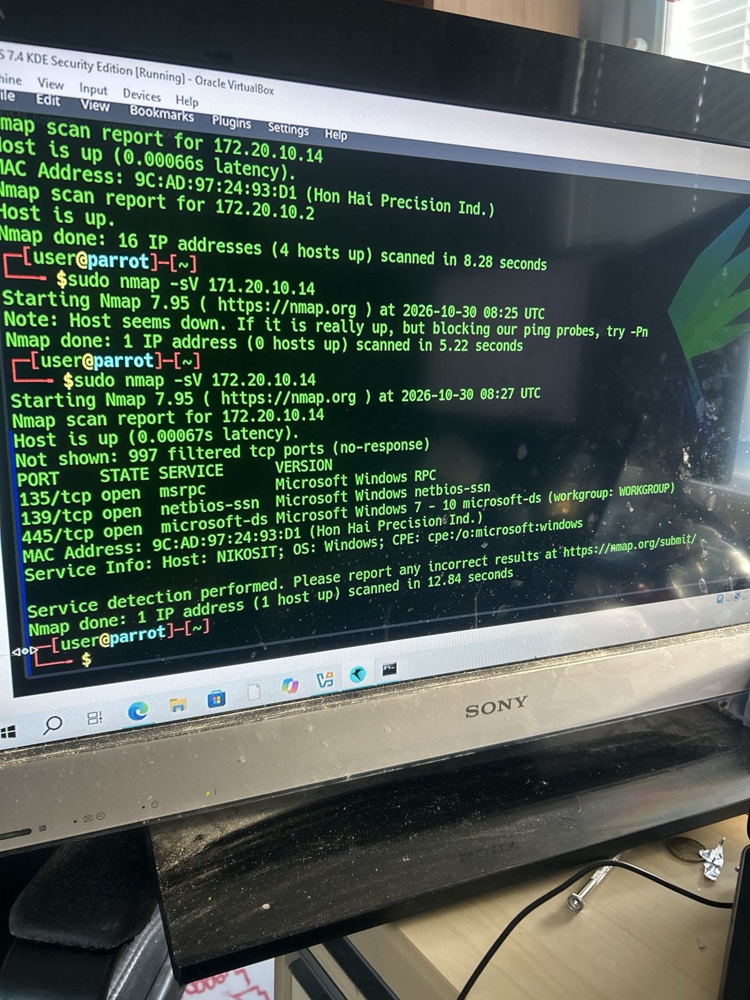
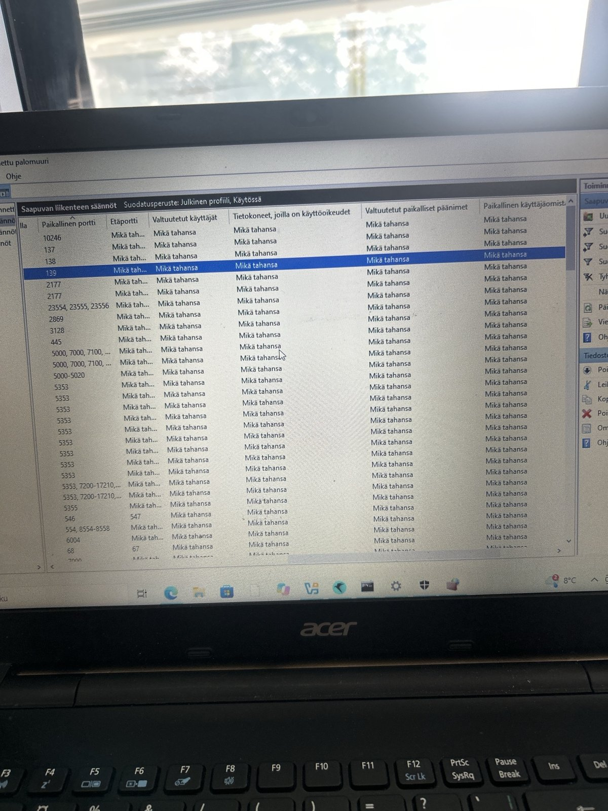
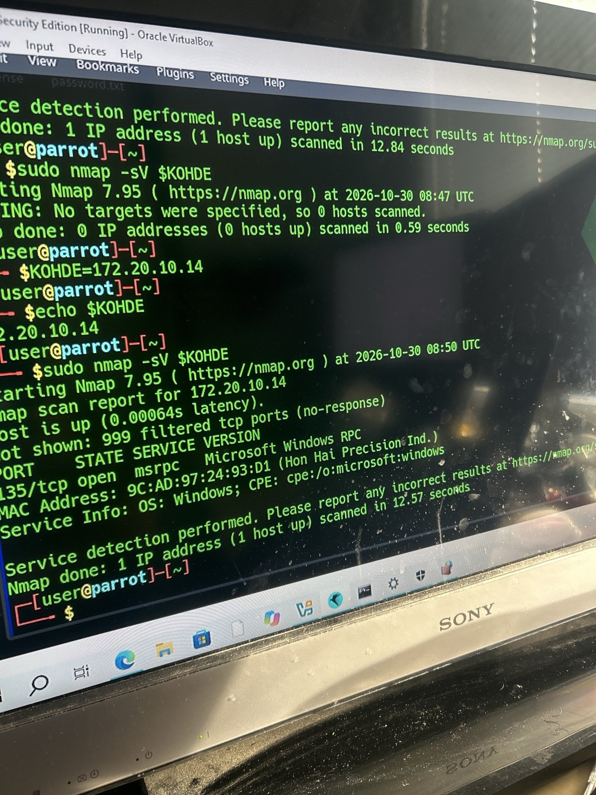

# Lokikirja: Porttiskannaus ja palomuurin koventaminen

30.10.2026 · Nikos Eliassi

## Tiivistelmä

Löysin omasta Windows-koneestani tietoturvaongelman ja korjasin sen: tiedostojaon portit 139 ja 445 olivat auki julkisessa verkossa, vaikka palomuuri oli päällä. Palomuurisääntöjen korjauksen jälkeen avoimia portteja oli 3 sijaan 1, eikä koneen nimi enää näkynyt verkkoon.

En päässyt kampuspäivälle 30.10.2026, joten tein samat aiheet itsenäisesti: porttiskannauksen nmapilla ja verkkoliikenteen kaappauksen Wiresharkilla. Harjoitus kesti noin 1,5 tuntia (klo 9.35–11.00). Työskentelin vain omassa verkossa ja omilla laitteillani.

## Ympäristö ja välineet

Harjoitusverkkona oli puhelimeni jakama hotspot, jossa oli vain omia laitteitani.

| Osa | Tieto |
| --- | --- |
| Isäntäkone | Acer-kannettava, Windows 10, osoite 172.20.10.14, koneen nimi NIKOSIT |
| Virtualisointi | Oracle VirtualBox, verkkoasetus vaihdettu NAT → Bridged Adapter |
| Hyökkäyskone | Parrot OS 7.4 KDE Security Edition (virtuaalikone), osoite 172.20.10.2 |
| Verkko | iPhonen hotspot, 172.20.10.0/28 (16 osoitetta), yhdyskäytävä 172.20.10.1 |
| Työkalut | nmap 7.95, Wireshark 4.4.19, Windows Defenderin laajennettu palomuuri, ipconfig, ip a |

## Eettiset rajat

Skannasin vain omaa hotspot-verkkoani ja omia laitteitani. Korkein oikeus on katsonut luvattoman porttiskannauksen tietomurron yritykseksi (KKO 2003:36), joten koulun, työpaikan tai taloyhtiön verkko ei kelpaa harjoitusalustaksi.

Noudatin näitä sääntöjä:

- Kohteena vain osoitealue 172.20.10.0/28, jonka tunnistin ensin Windowsin ipconfig-komennolla.
- Bridged-tila vain omassa verkossa. Koulun tai julkisen Wi-Fin kanssa virtuaalikone pidetään NAT-tilassa.
- Kohdeosoite tallennetaan muuttujaan ja tarkistetaan ennen skannausta, koska kirjoitusvirhe voi ohjata skannauksen vieraaseen verkkoon (ks. Virheet ja niistä opitut).

## Lokikirja

Ajat ovat Suomen aikaa. Nmapin tulosteissa näkyy UTC-aika, joka on 2 tuntia vähemmän.

| Aika | Mitä tein | Komento tai työkalu | Tulos ja havainto |
| --- | --- | --- | --- |
| n. 9.50 | Päivitin järjestelmän ja asensin työkalut | `sudo apt update && sudo apt full-upgrade -y`, `sudo apt install nmap wireshark` | Päivitys ja asennus onnistuivat. |
| n. 9.55 | Etsin laitteita oletetusta kotiverkosta | `sudo nmap -sn 192.168.1.0/24` | 256/256 osoitetta "up" 59,77 sekunnissa. Väärä positiivinen tulos: verkko oli väärä, ja VirtualBoxin NAT vastasi kaikkiin kyselyihin. |
| 9.56 | Käynnistin Wiresharkin | `sudo wireshark` | Liitännät enp0s3, any ja lo näkyivät. Pääte jäi varatuksi Wiresharkille. |
| 10.00–10.05 | Yritin käynnistää verkon uudelleen | `sudo systemctl restart NetworkManger` | Virhe: palvelun nimessä oli kirjoitusvirhe. Keskeytin jonossa olleet komennot Ctrl+C:llä ennen kuin virheellinen skannaus `191.168.1.0/24` ehti käynnistyä. |
| 10.11 | Selvitin hotspot-verkon tiedot Windowsissa | `ipconfig` | Osoite 172.20.10.14, maski 255.255.255.240 (/28), yhdyskäytävä 172.20.10.1. |
| 10.15 | Tarkistin virtuaalikoneen verkkoasetuksen | VirtualBox Manager → Settings → Network | Adapter 1 oli NAT. Vaihdoin sen tilaan Bridged Adapter. |
| 10.20 | Tarkistin Parrotin osoitteen ja etsin verkon laitteet | `ip a`, `sudo nmap -sn 172.20.10.0/28` | Parrot sai osoitteen 172.20.10.2. Löytyi 4 laitetta 8,28 sekunnissa: puhelin (.1), Parrot (.2), toinen tietokone Intel-verkkokortilla (.3) ja oma kannettava (.14, Hon Hai). |
| 10.25 | Porttiskannaus, osoitteessa kirjoitusvirhe | `sudo nmap -sV 171.20.10.14` | Vieras julkinen osoite ei vastannut, joten porttiskannausta ei tehty. |
| 10.27 | Porttiskannaus omaan kannettavaan | `sudo nmap -sV 172.20.10.14` | Auki 135 (msrpc), 139 (netbios-ssn) ja 445 (microsoft-ds), 997 suodatettu. Koneen nimi NIKOSIT ja työryhmä WORKGROUP näkyivät. |
| 10.31 | Tarkistin Windowsin verkkoprofiilin | Asetukset → Verkko ja Internet → Tila | Hotspot oli jo luokiteltu julkiseksi verkoksi. |
| 10.34 | Tarkistin palomuurin tilan | Windowsin suojaus → Palomuuri ja verkon suojaus | Palomuuri oli päällä kaikissa kolmessa profiilissa. |
| 10.36–10.43 | Etsin portit avaavat säännöt | Laajennettu palomuuri → Saapuvan liikenteen säännöt, suodatus Julkinen + Käytössä, järjestys portin mukaan | Käytössä olivat säännöt porteille 137, 138, 139 ja 445. Poistin ne käytöstä. |
| 10.47 | Uusintaskannaus | `sudo nmap -sV $KOHDE` | Ei tulosta: muuttujaa ei ollut asetettu tässä päätteessä. |
| 10.50 | Uusintaskannaus muuttujalla | `KOHDE=172.20.10.14`, `echo $KOHDE`, `sudo nmap -sV $KOHDE` | Vain 135 auki ja 999 suodatettu. Koneen nimi ei enää näkynyt. |
| 11.00 | Kokosin tulokset | Excel-taulukko [Porttiskannaus_vertailu.xlsx](Porttiskannaus_vertailu.xlsx) | Ennen ja jälkeen -vertailu sekä portin 135 tehtävälista. |

## Keskeiset havainnot

Tärkein havainto: palomuuri oli päällä ja verkko julkinen, mutta tiedostojaon portit olivat silti auki, koska palomuurissa oli niille sallivat säännöt.

1. **Työkalun tulosta ei voi uskoa sellaisenaan.** Ensimmäinen skannaus näytti 256 laitetta. Syy oli virtuaalikoneen NAT-tila: VirtualBox vastasi itse jokaiseen kyselyyn. Bridged-tilassa oikeassa verkossa laitteita oli 4.
2. **Verkon laitteet tunnistettiin MAC-osoitteista.** Valmistajatunnisteesta näki Hon Hai -verkkokortin (oma kannettava) ja Intel-verkkokortin (toinen tietokone). Puhelimen valmistaja oli "Unknown", koska iPhone käyttää satunnaistettua MAC-osoitetta. Parrotin MAC-osoite (08:00:27…) paljastaa sen VirtualBox-virtuaalikoneeksi.
3. **Kannettava paljasti verkkoon enemmän kuin piti.** Portit 139 ja 445 (SMB) olivat auki julkisessa verkossa. SMB:n kautta nmap sai myös koneen nimen NIKOSIT ja työryhmän WORKGROUP. Portin 445 kautta levisi WannaCry-kiristyshaittaohjelma vuonna 2017.
4. **Syy löytyi palomuurin säännöistä.** Laajennetussa palomuurissa oli julkisessa profiilissa käytössä säännöt porteille 137, 138, 139 ja 445. Portit 137 ja 138 käyttävät UDP:tä, joten nmapin oletusskannaus (vain TCP) ei näyttänyt niitä.

*Kuva 1. NAT-tilassa skannaus näytti kaikki 256 osoitetta päällä olevina (väärä positiivinen tulos).*

*Kuva 2. Bridged-tilassa Parrot sai osoitteen 172.20.10.2, ja skannaus löysi 4 todellista laitetta.*

## Tehty korjaus ja tulos

Poistin käytöstä neljä saapuvan liikenteen sääntöä, jotka sallivat tiedostojaon julkisessa verkossa. Valitsin poistamisen sijaan käytöstä poistamisen, jotta muutoksen voi tarvittaessa perua.

| Mittari | Ennen (klo 10.27) | Jälkeen (klo 10.50) |
| --- | --- | --- |
| Avoimet TCP-portit | 135, 139, 445 | 135 |
| Suodatetut portit (1000:sta) | 997 | 999 |
| Koneen nimi ja työryhmä näkyvät | Kyllä (NIKOSIT, WORKGROUP) | Ei |
| Käyttöjärjestelmä tunnistettiin | Windows 7–10 | Windows |

Korjaus toimi: hyökkääjä saa koneesta nyt vähemmän tietoa, eikä SMB-palvelu ole tavoitettavissa julkisessa verkossa.

*Kuva 3. Ennen korjausta: portit 135, 139 ja 445 auki, koneen nimi NIKOSIT näkyy.*

*Kuva 4. Laajennetun palomuurin säännöt julkisessa profiilissa, järjestettynä portin mukaan. Rivit 137, 138, 139 ja 445 poistettiin käytöstä.*

*Kuva 5. Korjauksen jälkeen: vain portti 135 auki, 999 porttia suodatettu.*

## Virheet ja niistä opitut

Vakavin virheeni oli kohdeosoitteen kirjoittaminen väärin kahdesti, koska skannaus olisi voinut kohdistua vieraaseen verkkoon.

| Virhe | Mitä tapahtui | Mitä opin ja muutin |
| --- | --- | --- |
| `191.168.1.0/24` kirjoitettu `192.168.1.0/24`:n sijaan | Komento jäi jonoon, ja keskeytin sen Ctrl+C:llä ennen suoritusta. | Tarkistan osoitteen ennen Enteriä. Kaikki harjoitusverkon osoitteet alkavat `172.20.10.`. |
| `171.20.10.14` kirjoitettu `172.20.10.14`:n sijaan | Nmap lähetti muutaman ping-kyselyn vieraaseen julkiseen osoitteeseen. Kohde ei vastannut, eikä porttiskannausta tehty. | Otin käyttöön muuttujan `KOHDE` ja tarkistan sen `echo`-komennolla ennen skannausta. En noudattanut nmapin ehdotusta `-Pn`, joka olisi pakottanut porttiskannauksen. |
| `sudo wireshark` varasi päätteen | Seuraavat komennot jäivät jonoon ja olisivat käynnistyneet Wiresharkin sulkeutuessa. | Avaan Wiresharkille oman välilehden (Ctrl+Shift+T). |
| `NetworkManger` | Palvelua ei löytynyt. | Kopioin komennot ja liitän ne päätteeseen näppäimillä Ctrl+Shift+V. |
| Vanhan tulosteen liittäminen päätteeseen | Pääte yritti suorittaa tulosterivejä komentoina. | Liitän vain komentorivit. |
| `$KOHDE` tyhjä | Nmap ei skannannut mitään. | Muuttuja on voimassa vain siinä päätteessä, jossa se asetettiin. |

## Mitä opin

Opin, että sama työkalu palvelee sekä hyökkääjää että puolustajaa: tiedustelulla löysin oman koneeni heikkouden ja pystyin korjaamaan sen.

| Opintojakson tavoite | Mitä opin tässä harjoituksessa |
| --- | --- |
| Tiedot: hakkerointityökalujen toimintaperiaatteet | Miten nmap tunnistaa laitteet (`-sn`) ja palvelut versioineen (`-sV`). Mitä tilat open, closed ja filtered tarkoittavat. Miksi oletusskannaus näyttää vain TCP-portit. |
| Tiedot: haavoittuvuuksien syntyminen | Avoin SMB-portti julkisessa verkossa on riski (WannaCry 2017). Haavoittuvuus syntyi asetuksesta, ei ohjelmistovirheestä. |
| Taidot: työkalujen käyttö | Virtuaalikoneen verkkotilat (NAT ja Bridged), verkon rajaus aliverkon peitteestä (/28 = 16 osoitetta), Wiresharkin liitännät, palomuurisääntöjen suodatus ja järjestäminen. |
| Taidot: haavoittuvuuksien tunnistaminen ja analysointi | Tunnistin avoimet portit, selvitin niiden syyn palomuurisäännöistä ja varmistin korjauksen uusintaskannauksella. |
| Taidot: suojaus- ja torjuntamenetelmät | Poistin tarpeettomat palomuurisäännöt käytöstä ja mittasin vaikutuksen ennen ja jälkeen. |
| Vastuu: työskentely vain luvallisessa ympäristössä | Rajasin työn omaan hotspot-verkkoon ja omiin laitteisiin. Tunnistin kirjoitusvirheiden riskin ja otin käyttöön tarkistuskäytännön. |
| Vastuu: hyökkääjän ja puolustajan näkökulma | Näin, mitä tietoa koneestani saa verkosta, ja minimoin sen. |

## Jatkotoimet

Seuraavaksi suljen portin 135 ja tarkistan UDP-portit, jotta korjaus on kattava.

- [ ] Selvitä portin 135 (RPC) sääntö palomuurista. Se näkyy tekstinä RPC-päätepistekartoitus, ja Blaster-mato levisi sen kautta vuonna 2003.
- [ ] Skannaa UDP-portit 137 ja 138: `sudo nmap -sU -p 137,138 $KOHDE`.
- [ ] Varmista, ettei SMBv1 ole käytössä.
- [ ] Tee Wireshark-harjoitus loppuun: kaappaus liitännästä enp0s3 ja suodatin `dns`.
- [ ] Varmista laitteen 172.20.10.3 (Intel-verkkokortti) tunnistus.
